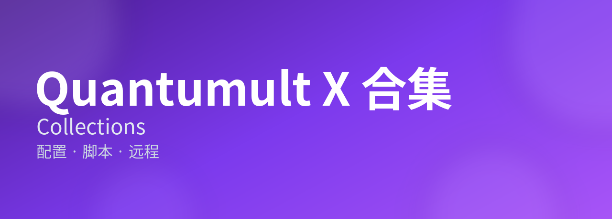

[English](README_EN.md) · [简体中文](README.md) · 日本語 · [한국어](README_KO.md) · [Türkçe](README_TR.md)

# QuantumultX

設定 · スクリプト · リモート

## 📖 使い方

QuantumultX は Quantumult X 用の設定とスクリプトのコレクションです。`configs/` にそのまま使える設定ファイル、`scripts/` に対応するアンロックスクリプトが入っています。リンクを貼るだけで購読でき、自分でルールを書く必要はありません。

### 内容

- [Collections.conf](https://raw.githubusercontent.com/lzr52o/QuantumultX/master/configs/Collections.conf)：アプリのアンロック集。多くのアプリの会員アンロック用リライトルール。
- [revenuecat-markbuy.qx.conf](https://raw.githubusercontent.com/lzr52o/QuantumultX/master/configs/revenuecat-markbuy.qx.conf)：MarkBuy Pro、RevenueCat オールインワンアンロック。
- [unlock-collection.qx.conf](https://raw.githubusercontent.com/lzr52o/QuantumultX/master/configs/unlock-collection.qx.conf)：アンロック集、24本のスクリプト：広告除去、会員アンロック、価格履歴、Netflix 評価、クイズ解答アシスタント。
- [v2ex-checkin.qx.conf](https://raw.githubusercontent.com/lzr52o/QuantumultX/master/configs/v2ex-checkin.qx.conf)：V2EX 毎日自動チェックイン。
- [weibo-enhanced.qx.conf](https://raw.githubusercontent.com/lzr52o/QuantumultX/master/configs/weibo-enhanced.qx.conf)：微博アシスタント。微博の広告やプロモーション投稿を除去。

`scripts/` の6本のスクリプト（Adapty、NotBoring、revenuecat.vip、vvebo、PhotoRetouch、TouchreTouch）は各アプリのアンロックスクリプトです。上の設定を購読すれば自動で参照されるので、通常は個別に追加する必要はありません。

### 必要なもの

- iPhone または iPad にインストールされた Quantumult X（App Store の有料アプリ）。
- GitHub（raw.githubusercontent.com）にアクセスできるネットワーク。
- アンロック機能には HTTPS 復号（MITM）が必要です。Quantumult X で証明書をインストールし、iOS の「設定 → 一般 → 情報 → 証明書信頼設定」で信頼してください。信頼しないとスクリプトは動きません。

### 購読方法

1. 上から使いたい設定のリンクをコピーします。
2. Quantumult X を開き、右下の「設定」→「プロファイル」をタップします。
3. 右上のダウンロードアイコンをタップし、リンクを貼り付けて「確定」をタップします。
4. ダウンロードが終わったら、そのプロファイルをタップして切り替えます。

Safari で設定リンクを開き、共有メニューから「Quantumult X で開く」を選ぶ方法もあります。

### スクリプトを1本だけ使う方法

1. `scripts/` で使いたいスクリプトを探し、raw リンクをコピーします。形式は `https://raw.githubusercontent.com/lzr52o/QuantumultX/master/scripts/スクリプト名` です。
2. Quantumult X を開き、右下の「設定」→「リライト」をタップします。
3. 右上の「+」をタップしてリライトルールを追加し、スクリプトの URL 欄にリンクを貼り付けて保存します。
4. ホーム画面に戻り、「リライト」スイッチをオンにします。

### よくある質問

- **購読したのに効かない？** 3点を確認してください：プロファイルを切り替えたか、「リライト」スイッチがオンか、証明書をインストールして信頼したか。全部OKなら、アプリを一度閉じて開き直すか、「購入を復元」をタップして試してください。
- **リンクが開けない？** ネットワークから GitHub にアクセスできるか確認してください。まず Safari でリンクを開いてみてください。
- **更新方法は？** 設定はリモート購読です。Quantumult X の「プロファイル」でタップすれば最新版に更新できます。再購読は不要です。
- **V2EX チェックインの使い方は？** v2ex-checkin.qx.conf を購読したら、設定内の `User` の後ろの `.*` を自分の V2EX ユーザー名に書き換え、最初に一度 V2EX の個人ページを開いて Cookie を取得させてください。その後は毎日 00:10 に自動でチェックインします。
- **Netflix の評価が表示されない？** アンロック集の Netflix 評価には IMDb API キーが必要です。BoxJs で `ImdbApikeyCacheKey` を入力してください。
- **微博の広告が消えない？** 微博アシスタントを使うときは、まず Quantumult X の「互換性向上」スイッチをオフにしてください。

## ⚠️ 利用上の注意

本リポジトリは個人の学習およびサブスクリプション利用のみを目的としています。**転載、転送、二次配布および商用利用を禁止します**。詳しくは [LICENSE](./LICENSE) をご覧ください。

## 📊 統計

## 🛠️ 技術スタック

## 😄 今日の一言

## 🎮 コントリビューショングラフ

<picture>
  <source media="(prefers-color-scheme: dark)" srcset="https://contrib-rotate.lzr52o.workers.dev/rotate?theme=dark" />
  <source media="(prefers-color-scheme: light)" srcset="https://contrib-rotate.lzr52o.workers.dev/rotate?theme=light" />
  
</picture>

## 🙏 謝辞

本リポジトリに収録されているスクリプトとモジュールは、以下の原作者によるものです。ご尽力に感謝します：

[chxm1023](https://github.com/chxm1023)、[ddgksf2013（墨鱼）](https://github.com/ddgksf2013)、[NobyDa](https://github.com/NobyDa)、[yichahucha](https://github.com/yichahucha)、[ddm1023](https://github.com/ddm1023)、[彭于晏](https://github.com/fenyaprilia)、[WeiGiegie](https://github.com/WeiGiegie)、[bin64](https://github.com/bin64)、[凉心（52Lxcloud）](https://github.com/52Lxcloud)、[Alex0510](https://github.com/Alex0510)、[Choler](https://github.com/Choler)、[chavyleung](https://github.com/chavyleung)、Liquor030、YG、[leey668](https://github.com/leey668)、[wf021325](https://github.com/wf021325)、[zmqcherish](https://github.com/zmqcherish)

## ⚠️ 免責事項

本リポジトリは個人の学習用です。すべてのスクリプトとモジュールの著作権は原作者に帰属します。転載、ミラー、再配布、商用は禁止です。原作者の情報を削除しないでください。侵害がある場合は Telegram ボット [@ccccccccoBot](https://t.me/ccccccccoBot) までご連絡いただければ削除します。

