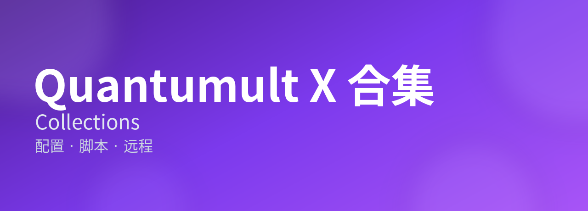

[English](README_EN.md) · [简体中文](README.md) · [日本語](README_JA.md) · 한국어 · [Türkçe](README_TR.md)

# QuantumultX

설정 · 스크립트 · 원격

## 📖 사용법

QuantumultX는 Quantumult X용 설정과 스크립트 모음집입니다. `configs/`에는 바로 쓸 수 있는 설정 파일이, `scripts/`에는 함께 쓰는 잠금 해제 스크립트가 들어 있습니다. 링크만 붙여넣으면 구독할 수 있어 직접 규칙을 쓸 필요가 없습니다.

### 구성

- [Collections.conf](https://raw.githubusercontent.com/lzr52o/QuantumultX/master/configs/Collections.conf): 앱 잠금 해제 모음. 여러 앱의 멤버십 잠금 해제를 위한 리라이트 규칙.
- [revenuecat-markbuy.qx.conf](https://raw.githubusercontent.com/lzr52o/QuantumultX/master/configs/revenuecat-markbuy.qx.conf): MarkBuy Pro, RevenueCat 올인원 잠금 해제.
- [unlock-collection.qx.conf](https://raw.githubusercontent.com/lzr52o/QuantumultX/master/configs/unlock-collection.qx.conf): 잠금 해제 모음, 24개 스크립트: 광고 제거, 멤버십 잠금 해제, 가격 기록, Netflix 평점, 퀴즈 정답 도우미.
- [v2ex-checkin.qx.conf](https://raw.githubusercontent.com/lzr52o/QuantumultX/master/configs/v2ex-checkin.qx.conf): V2EX 매일 자동 출석 체크.
- [weibo-enhanced.qx.conf](https://raw.githubusercontent.com/lzr52o/QuantumultX/master/configs/weibo-enhanced.qx.conf): 웨이보 도우미. 웨이보 광고와 홍보 게시물을 제거합니다.

`scripts/`의 6개 스크립트(Adapty, NotBoring, revenuecat.vip, vvebo, PhotoRetouch, TouchreTouch)는 각 앱의 잠금 해제 스크립트입니다. 위 설정을 구독하면 자동으로 참조되므로 보통 따로 추가할 필요가 없습니다.

### 필요한 것

- iPhone 또는 iPad에 설치된 Quantumult X(App Store 유료 앱).
- GitHub(raw.githubusercontent.com)에 접속할 수 있는 네트워크.
- 잠금 해제 기능에는 HTTPS 복호화(MITM)가 필요합니다. Quantumult X에서 인증서를 설치한 뒤 iOS 「설정 → 일반 → 정보 → 인증서 신뢰 설정」에서 신뢰해 주세요. 신뢰하지 않으면 스크립트가 동작하지 않습니다.

### 구독 방법

1. 위에서 원하는 설정의 링크를 복사합니다.
2. Quantumult X를 열고 오른쪽 아래 「설정」→「프로파일」을 탭합니다.
3. 오른쪽 위 다운로드 아이콘을 탭하고 링크를 붙여넣은 뒤 「확인」을 탭합니다.
4. 다운로드가 끝나면 해당 프로파일을 탭해 전환합니다.

Safari에서 설정 링크를 열고 공유 메뉴에서 「Quantumult X에서 열기」를 선택하는 방법도 있습니다.

### 스크립트 하나만 따로 쓰는 방법

1. `scripts/`에서 원하는 스크립트를 찾아 raw 링크를 복사합니다. 형식은 `https://raw.githubusercontent.com/lzr52o/QuantumultX/master/scripts/스크립트 이름`입니다.
2. Quantumult X를 열고 오른쪽 아래 「설정」→「재작성」을 탭합니다.
3. 오른쪽 위 「+」를 탭해 재작성 규칙을 추가하고 스크립트 URL 란에 링크를 붙여넣어 저장합니다.
4. 홈 화면으로 돌아가 「재작성」 스위치를 켭니다.

### 자주 묻는 질문

- **구독했는데 적용이 안 돼요?** 세 가지를 확인하세요. 새 프로파일로 전환했는지, 「재작성」 스위치가 켜져 있는지, 인증서를 설치하고 신뢰했는지. 모두 괜찮다면 앱을 완전히 닫았다 다시 열거나 「구입 복원」을 탭해 다시 시도하세요.
- **링크가 안 열려요?** 네트워크에서 GitHub에 접속할 수 있는지 확인하세요. 먼저 Safari에서 링크를 열어 보세요.
- **업데이트는 어떻게 하나요?** 설정은 원격 구독입니다. Quantumult X의 「프로파일」에서 탭하면 최신 버전으로 새로고침됩니다. 다시 구독할 필요가 없습니다.
- **V2EX 출석 체크는 어떻게 쓰나요?** v2ex-checkin.qx.conf를 구독한 뒤 설정에서 `User` 뒤의 `.*`를 본인의 V2EX 사용자 이름으로 바꾸고, 처음에 한 번 V2EX 개인 페이지를 열어 쿠키를 가져오게 하세요. 이후 매일 00:10에 자동으로 출석 체크합니다.
- **Netflix 평점이 안 보여요?** 잠금 해제 모음의 Netflix 평점에는 IMDb API 키가 필요합니다. BoxJs에서 `ImdbApikeyCacheKey`를 입력하세요.
- **웨이보 광고가 안 지워져요?** 웨이보 도우미를 쓸 때는 먼저 Quantumult X의 「호환성 강화」 스위치를 꺼 주세요.

## ⚠️ 이용 안내

이 저장소는 개인 학습 및 구독 용도로만 제공됩니다. **전재, 재배포, 2차 배포 및 상업적 이용을 금지합니다.** 자세한 내용은 [LICENSE](./LICENSE)를 참조하세요.

## 📊 통계

## 🛠️ 기술 스택

## 😄 오늘의 한마디

## 🎮 기여 그래프

<picture>
  <source media="(prefers-color-scheme: dark)" srcset="https://contrib-rotate.lzr52o.workers.dev/rotate?theme=dark" />
  <source media="(prefers-color-scheme: light)" srcset="https://contrib-rotate.lzr52o.workers.dev/rotate?theme=light" />
  
</picture>

## 🙏 감사

이 저장소에 수록된 스크립트와 모듈은 다음 원작자들의 것입니다. 수고에 감사드립니다：

[chxm1023](https://github.com/chxm1023)、[ddgksf2013（墨鱼）](https://github.com/ddgksf2013)、[NobyDa](https://github.com/NobyDa)、[yichahucha](https://github.com/yichahucha)、[ddm1023](https://github.com/ddm1023)、[彭于晏](https://github.com/fenyaprilia)、[WeiGiegie](https://github.com/WeiGiegie)、[bin64](https://github.com/bin64)、[凉心（52Lxcloud）](https://github.com/52Lxcloud)、[Alex0510](https://github.com/Alex0510)、[Choler](https://github.com/Choler)、[chavyleung](https://github.com/chavyleung)、Liquor030、YG、[leey668](https://github.com/leey668)、[wf021325](https://github.com/wf021325)、[zmqcherish](https://github.com/zmqcherish)

## ⚠️ 면책 조항

이 저장소는 개인 학습용입니다. 모든 스크립트와 모듈의 저작권은 원작자에게 있습니다. 전재, 미러링, 재배포, 상업적 이용을 금지합니다. 원작자 정보를 삭제하지 마세요. 침해가 있으면 Telegram 봇 [@ccccccccoBot](https://t.me/ccccccccoBot)으로 연락 주시면 삭제하겠습니다.

