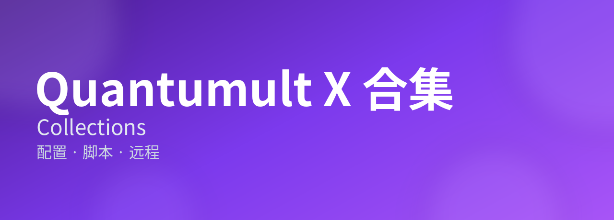

[English](README_EN.md) · [简体中文](README.md) · [日本語](README_JA.md) · [한국어](README_KO.md) · Türkçe

# QuantumultX

Yapılandırma · Betik · Uzaktan

## ⚠️ Kullanım Bildirimi

Bu depo yalnızca kişisel öğrenme ve abonelik kullanımı içindir. **Yeniden yayınlamak, aktarmak, yeniden dağıtmak ve ticari amaçla kullanmak yasaktır.** Ayrıntılar için [LICENSE](./LICENSE) dosyasına bakın.

## 📊 İstatistikler

## 🛠️ Teknoloji Yığını

## 😄 Günün Sözü

## 🎮 Katkı Grafiği

<picture>
  <source media="(prefers-color-scheme: dark)" srcset="https://contrib-rotate.lzr52o.workers.dev/rotate?theme=dark" />
  <source media="(prefers-color-scheme: light)" srcset="https://contrib-rotate.lzr52o.workers.dev/rotate?theme=light" />
  
</picture>

